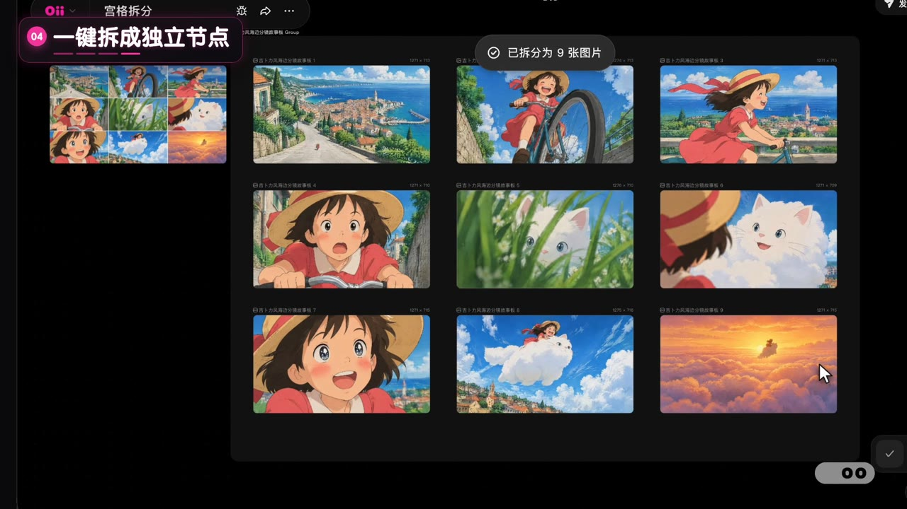

# 宫格拆分功能介绍

OiiOii「宫格拆分」功能介绍：选中一张宫格图，更多 → 宫格拆分，自定义行列，一键拆成独立节点；再看 7 种拆开后的用法。无口播，靠字幕 + 花字 + 背景音乐。


| | |
|---|---|
| 状态 | ✅ 成品 v5（2026-10-13） |
| 成片 | [⬇️ 下载 1080p 成片（25MB）](https://github.com/junejuneli/oii-videos/releases/download/grid-split-v5/oiioii-grid-split-v5-1080p.mp4) · [Release 页面](https://github.com/junejuneli/oii-videos/releases/tag/grid-split-v5) |
| 规格 | 1920×1080，30fps，46.6 秒，H.264 + AAC，-16 LUFS |

## 内容

| 时间（约） | 段落 | 画面 |
|---|---|---|
| 0–2s | 封面 | 「宫格图 / 一键拆开」，吉卜力分镜 9 张小卡依次放大，卖点「拆成独立节点，免费使用」 |
| 2–20s | 01–04 教程 | 选中宫格图 → 更多 → 宫格拆分 → 自定义宫格（选行列）→ 一键拆成 9 个独立节点；关键操作放慢并加流光圈 |
| 20–42s | 案例 × 7 | 短剧分镜、分镜故事板、角色形象套图、电商套图、游戏道具图标、技能特效帧等：原图 → 格子拉开 → 「拆开后 · N 张独立图片」 |
| 42–47s | 落版 + 片尾 | 标语 + OiiOii 片尾 Logo |



需求、素材和 v1–v5 的完整迭代记录见 [brief.md](brief.md)。

## 工程

```
src/
  Main.tsx       时间线：recK 教程镜头表、步骤字幕、流光框、案例衔接、配乐
  Cover.tsx      封面
  Showcase.tsx   7 个案例展示（拼合原图 → 拉开 → 应用场景）
  EndCenter.tsx  落版
public/
  rec/recK.mp4   51.8s 画布录屏（吉卜力分镜）
  assets/        案例图（拆分后的 cell 图）
  sfx/music.wav  配乐（make-music-light.mjs，105 BPM，44s）
media.lock.json  本地大文件清单
```

录屏、配乐等大文件只在本地，不进 git；`pnpm media:check` 可以检查是否齐全。

```bash
pnpm --filter grid-split dev          # 打开 Remotion Studio
pnpm --filter grid-split music        # 重新合成配乐
pnpm --filter grid-split release v6   # 渲染母版 + 分享版到 out/
```
