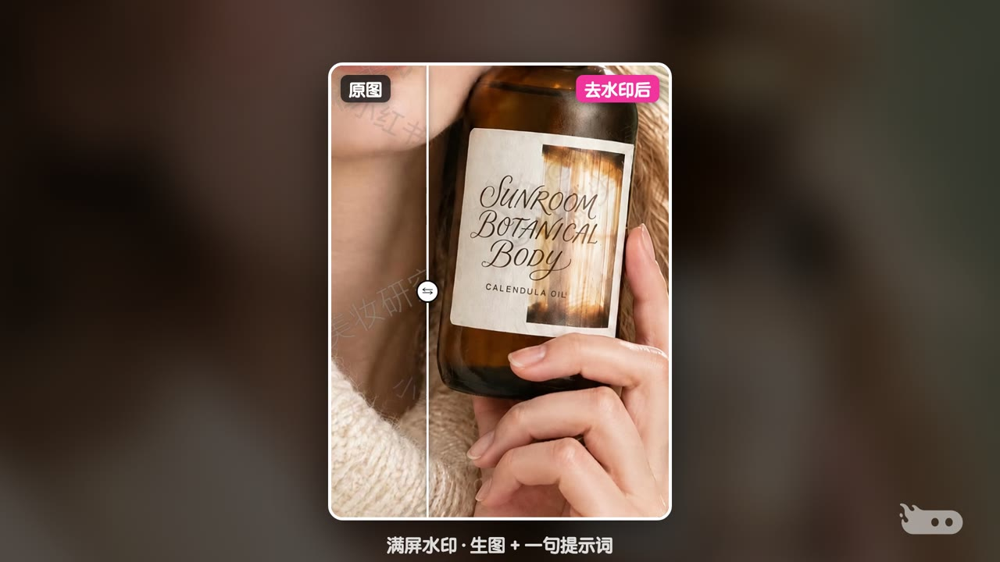

# 图片去水印

OiiOii 图片去水印功能介绍：两个小技巧——局部水印用「移除物体」涂一涂，满屏水印用右键「生图」+ 一句提示词。无口播，靠字幕 + 花字 + 贴纸 + 背景音乐。


| | |
|---|---|
| 状态 | ✅ 成品 v7（2026-10-16） |
| 成片 | [⬇️ 下载 1080p 成片（19MB）](https://github.com/junejuneli/oii-videos/releases/download/image-watermark-removal-v7/oiioii-image-watermark-removal-v7-1080p.mp4) · [Release 页面](https://github.com/junejuneli/oii-videos/releases/tag/image-watermark-removal-v7) |
| 规格 | 1920×1080，30fps，60 秒，H.264 + AAC，-16 LUFS |

## 内容

| 时间（约） | 段落 | 画面 |
|---|---|---|
| 0–2s | 封面 | 「图片轻松去水印」，两张卡（满屏水印 / 去水印后）+ 放大镜对比，副标题「涂一涂、说一句，水印退退退」 |
| 2–5s | 开场 | 评论区刷「求无水印原图」→「不用求了，自己擦」 |
| 5–7s | 转场 · 技巧 1 | 工具栏截图圈出「移除物体」 |
| 7–24s | 技巧 1 · 局部水印 | 选中图片 → 移除物体 → 涂抹右下角水印（笔刷指示）→ 发送 → 结果在画布里出现 |
| 24–30s | 对比 | 推近水印处，左右滑动对比，「✓ 水印没了」 |
| 30–32s | 转场 · 技巧 2 | 右键菜单截图圈出「生图」 |
| 32–53s | 技巧 2 · 满屏水印 | 右键图片 → 生图 → 输入「去除这个图片里的各种水印，但是保留原图不变」→ 发送 → 结果出现 |
| 53–58s | 对比 | 推近瓶身和手部的多层水印，滑动对比，「✓ 满屏水印也没了」 |
| 58–60s | 片尾 | OiiOii 片尾 Logo |



需求、素材和 v1–v7 的完整迭代记录见 [brief.md](brief.md)。

## 工程

```
src/
  Main.tsx      时间线：imgA/imgB 镜头表、步骤字幕、流光框、花字、笔刷指示、结果扫出
  Cover.tsx     封面（两张卡 + 放大镜）
  Opening.tsx   评论区开场
  Wipe.tsx      转场（入口截图 + 高亮）
  Compare.tsx   原图 / 结果左右滑动对比
public/
  rec/          画布录屏 imgA（移除物体）、imgB（右键生图）
  raw/canvas/   画布里的原图（下载）
  raw/result/   画布里的结果图（下载）
  assets/       工具栏 / 菜单截图、录屏末帧
  sfx/music.wav 配乐（make-music-light.mjs，105 BPM）
media.lock.json 本地大文件清单
```

录屏、原图、配乐等大文件只在本地，不进 git；`pnpm media:check` 可以检查是否齐全。

```bash
pnpm --filter image-watermark-removal dev          # 打开 Remotion Studio
pnpm --filter image-watermark-removal release v8   # 渲染母版 + 分享版到 out/
```
