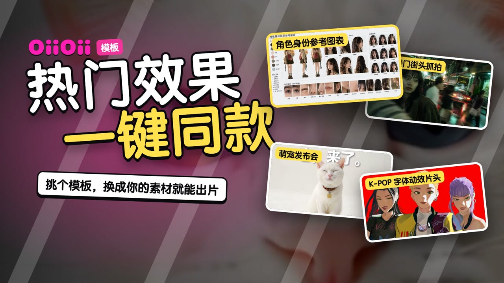
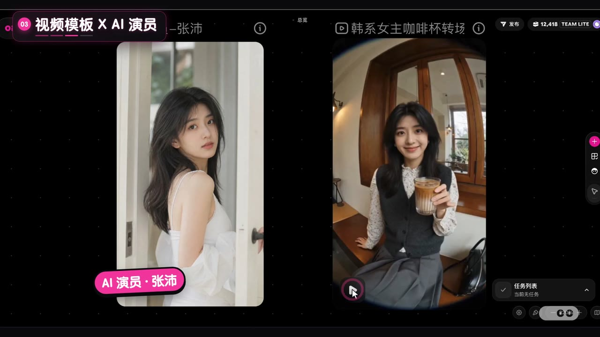

# 模板功能介绍

OiiOii「模板」功能介绍：热门效果，一键同款。输入框点「模板」，挑一个社区热门效果，换成自己的素材就能生成。无口播，靠字幕 + 花字 + 贴纸 + 背景音乐。



| | |
|---|---|
| 状态 | ✅ 成品 v4（2026-10-14） |
| 成片 | [⬇️ 下载 1080p 成片（62MB）](https://github.com/junejuneli/oii-videos/releases/download/template-library-v4/oiioii-template-library-v4-1080p.mp4) · [Release 页面](https://github.com/junejuneli/oii-videos/releases/tag/template-library-v4) |
| 规格 | 1920×1080，30fps，112 秒，H.264 + AAC，-16 LUFS |

## 内容

| 时间（约） | 段落 | 画面 |
|---|---|---|
| 0–2s | 封面 | 「热门效果 / 一键同款」，4 张案例卡跳动，卖点「挑个模板，换成你的素材就能出片」 |
| 2–34s | ① 图片模板 · 换成你的照片 | 点「模板」→ 搜索 → 选模板 → 换成自己的照片 → 生成 |
| 34–60s | ② 视频模板 · 一键同款 | 搜索 → 选模板 → 提示词里高亮的部分都能改（流光圈出）→ 生成并完整播放 |
| 60–80s | ③ 视频模板 × AI 演员 | 选「咖啡杯转场变装」→ 一键填好 → 生成 → 和 AI 演员并排出结果 |
| 80–97s | ④ 我的模板 | 把满意的效果存进「我的模板」，下次随时用 |
| 97–108s | 案例墙 | 4 图 + 6 视频案例，落版「挑一个模板，直接出片」 |
| 108–112s | 片尾 | OiiOii 片尾 Logo |



需求、素材和 v1–v4 的完整迭代记录见 [brief.md](brief.md)。

## 工程

```
src/
  Main.tsx       时间线：recA/B/C/C2/D 镜头表、步骤字幕、流光框、花字、贴纸、配乐
  Cover.tsx      封面（案例卡跳动）
  CaseWall.tsx   案例墙
  EndCenter.tsx  落版
public/
  rec/           画布录屏 recA/B/C/C2/D
  raw/           原始素材
  assets/        案例图和视频、封面卡片
  sfx/music.wav  配乐（make-music-light.mjs，105 BPM）
media.lock.json  本地大文件清单
```

录屏、原片、配乐等大文件只在本地，不进 git；`pnpm media:check` 可以检查是否齐全。

```bash
pnpm --filter template-library dev          # 打开 Remotion Studio
pnpm --filter template-library release v5   # 渲染母版 + 分享版到 out/
```
