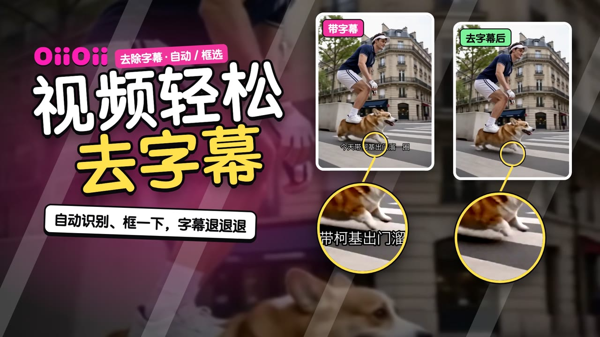
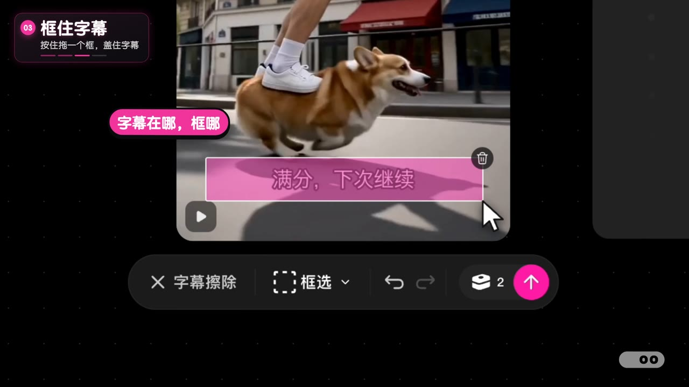

# 视频去字幕

OiiOii 视频去字幕功能介绍：工具栏「去除字幕」，默认自动识别字幕位置；识别不准时切到「框选」，框哪去哪。无口播，靠字幕 + 花字 + 贴纸 + 背景音乐。



| | |
|---|---|
| 状态 | ✅ 成品 v3（2026-10-16） |
| 成片 | [⬇️ 下载 1080p 成片（19MB）](https://github.com/junejuneli/oii-videos/releases/download/video-subtitle-removal-v3/oiioii-video-subtitle-removal-v3-1080p.mp4) · [Release 页面](https://github.com/junejuneli/oii-videos/releases/tag/video-subtitle-removal-v3) |
| 规格 | 1920×1080，30fps，52 秒，H.264 + AAC，-16 LUFS |

## 内容

| 时间（约） | 段落 | 画面 |
|---|---|---|
| 0–2s | 封面 | 「视频轻松去字幕」，两张卡（带字幕 / 去字幕后）+ 放大镜指向字幕 |
| 2–4s | 转场 · 技巧 1 | 工具栏截图圈出「去除字幕」 |
| 4–17s | 技巧 1 · 自动识别 | 选中视频 → 去除字幕 → 默认「自动」→ 发送 → 结果视频在画布里出现 |
| 17–22s | 对比 | 推近字幕区域，左右滑动对比，「✓ 字幕没了」 |
| 22–25s | 转场 · 技巧 2 | 下拉菜单截图圈出「框选」 |
| 25–45s | 技巧 2 · 手动框选 | 去除字幕 → 自动▾ → 框选 → 拖框盖住字幕 → 发送 → 结果出现 |
| 45–50s | 对比 | 推近字幕区域滑动对比，「✓ 框哪，去哪」 |
| 50–52s | 片尾 | OiiOii 片尾 Logo |



需求、素材和 v1–v3 的完整迭代记录见 [brief.md](brief.md)。

## 工程

```
src/
  Main.tsx      时间线：vidA/vidB 镜头表、步骤字幕、流光框、花字、框选动画、结果扫出
  Cover.tsx     封面（两张卡 + 放大镜）
  Wipe.tsx      转场（入口截图 + 高亮）
  Compare.tsx   原视频 / 结果左右滑动对比
public/
  rec/          画布录屏 vidA（自动）、vidB（框选）
  raw/canvas/   画布里的带字幕视频（下载）
  raw/result/   两个结果视频（下载）
  assets/       工具栏 / 下拉截图、录屏末帧、封面帧
  sfx/music.wav 配乐（make-music-groove.mjs，118 BPM）
media.lock.json 本地大文件清单
```

录屏、视频、配乐等大文件只在本地，不进 git；`pnpm media:check` 可以检查是否齐全。

```bash
pnpm --filter video-subtitle-removal dev          # 打开 Remotion Studio
pnpm --filter video-subtitle-removal release v4   # 渲染母版 + 分享版到 out/
```
